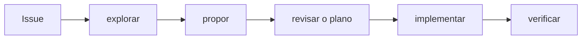

Quando um agente de IA escreve código rápido, o difícil deixa de ser digitar e passa a ser **saber o que foi pedido, o que foi feito e se está certo**. Sem isso, sobra muito código que parece certo e que ninguém sabe explicar logo depois.

Para lidar com isso, uso um fluxo simples num projeto pessoal, um [gestor financeiro em Django](https://github.com/leodramaral/projeto-gestor-financeiro). O método se chama **Spec-Driven Development (SDD)**: primeiro escrevo o que vai ser feito, depois reviso, e só então o agente implementa. Para isso uso o **OpenSpec**, e para dar um ponto de partida a cada trabalho, as **Issues do GitHub**.

## Uma regra só

No `AGENTS.md` do projeto, o arquivo que o agente lê antes de começar, está escrito:

> Não implemente sem uma change.

Uma *change* é uma pasta do OpenSpec que descreve o que vai mudar e por quê. Tela nova, regra de negócio nova, tabela nova, nada nasce fora de uma change. Vale para mim e vale para o agente.

## O que tem dentro de uma change

- **proposal**: por que existe, o que muda e o que fica **de fora**;
- **specs**: como o sistema deve se comportar, escrito como requisitos e cenários;
- **design**: as decisões técnicas e as alternativas que descartei;
- **tasks**: os passos, cada um com a forma de conferir se ficou pronto.

As specs são o que mais importa. Um trecho real, do cadastro de metas:

```markdown
### Requirement: Criação de meta
O usuário autenticado DEVE poder criar uma meta informando nome, valor-alvo
e, opcionalmente, um prazo. O prazo, se informado, NÃO DEVE estar no passado.

#### Cenário: Prazo no passado
- **QUANDO** o usuário envia um prazo anterior a hoje
- **ENTÃO** nenhuma meta é criada
- **E** o formulário exibe o erro do prazo em português
```

Eu consigo ler esse texto e discordar dele antes de existir qualquer código. E o agente usa o mesmo texto para saber quando terminou.

## O papel das Issues

A Issue é onde tudo começa: descreve o problema, o que se quer e os critérios de aceitação. O id da change é o número dela mais um nome, como `9-metas-financeiras`. A branch usa o mesmo id e os commits levam o número no começo (`feat(#9): metas financeiras…`). Assim, de qualquer commit eu volto até a Issue e até a spec que o justifica.

## O fluxo



1. **Issue.** O problema e os critérios de aceitação.
2. **Explorar.** Se a ideia pode ser lida de mais de um jeito, converso com o agente antes de propor qualquer coisa.
3. **Propor.** O agente gera proposal, specs, design e tasks de uma vez.
4. **Revisar o plano.** Eu leio tudo, corto, ajusto e decido. É a etapa em que errar sai mais barato, porque mudar uma frase custa muito menos do que mudar uma tela pronta.
5. **Implementar.** O agente segue as tasks na ordem e só marca uma como feita depois de conferir que funciona.
6. **Verificar.** Testes, validação das specs e uma conferência manual no navegador, comparando com os critérios da Issue.

O que aparece no meio do caminho tem destino certo. Se faz parte do escopo, vira task **antes** de ser feito. Se não faz, vira uma Issue nova e o trabalho atual não se desvia.

## Um caso real: a feature de metas

A [Issue #9](https://github.com/leodramaral/projeto-gestor-financeiro/issues/9) pedia metas financeiras: o usuário define um objetivo (por exemplo, juntar R$ 500), registra quanto já guardou e acompanha por uma barra de progresso. Estes foram os passos.

**Propor.** A proposta deixou claro o que entrava e o que ficava de fora. Entrava criar, editar, excluir, registrar progresso e concluir metas, com dados separados por usuário. Ficava de fora ligar a meta aos lançamentos ou ao saldo, histórico de aportes e lembretes de prazo. Guardar dinheiro numa meta, por exemplo, **não** cria lançamento. Isso evitou uma discussão que apareceria no meio da implementação.

**Revisar o plano.** Aqui o plano pedia algo incomum. A tela de metas ainda não existia, então a primeira tarefa era desenhar **duas opções de layout** e parar. Uma com cartões, outra com uma lista em linhas, igual à de lançamentos. A task seguinte era literalmente uma parada para decisão. Comparei as duas e escolhi a lista: é mais compacta e combina com o resto do app. A escolha ficou registrada no `design.md`, com o motivo, e a opção descartada foi removida. Nenhuma linha de código tinha sido escrita.

**Implementar.** Só depois da escolha o agente seguiu as tasks, começando pelo modelo e pelas regras (valor-alvo maior que zero, prazo que não pode estar no passado, barra limitada a 100%), depois os formulários, as telas e os testes de acesso e de isolamento entre usuários. Cada task dizia como conferir. Por exemplo, os testes do modelo cobriam a barra em 0%, 50%, 99,9% (que mostra 99, não 100) e acima do alvo.

**Um desvio, tratado como manda o fluxo.** No meio do caminho, percebi que o campo de prazo pedia um seletor de data. Era do escopo, então virou um novo grupo de tasks no mesmo plano (com a biblioteca escolhida e o motivo anotados) e só depois foi feito. Se fosse outra coisa, teria virado Issue.

**Verificar.** A última task era conferir, um a um, os requisitos da spec e os critérios de aceitação da Issue contra o app e os testes. Só então a change foi arquivada, e a spec de metas passou a fazer parte das specs do projeto.

## Por que funciona para mim

- **Eu reviso o texto, não só o código.** Concordar com uma página de especificação é mais fácil do que entender um diff de dezenas de arquivos.
- **O agente tem um critério de fim.** "Pronto" quer dizer tasks conferidas, não código que compila.
- **O histórico explica as decisões.** Daqui a meses, "por que a lista e não os cartões?" tem resposta escrita, e não depende de ninguém lembrar, muito menos do agente, que não guarda conversa nenhuma.

## O que custa

Dá trabalho. Cada change me obriga a ler e ajustar o plano antes de ver qualquer tela funcionando. O agente escreve os documentos em minutos, mas quem confere se estão certos sou eu, e isso leva tempo.

Em mudança pequena, também pode ser exagero. Um bug simples, um ajuste de layout ou uma correção de texto não precisam de proposta nem de specs, e eu nem abro uma change.

Para decidir, me pergunto o que sai mais caro, escrever o plano ou consertar depois o que o agente entendeu errado. Quando a mudança mexe em regra de negócio, em tela ou em dados, escrever o plano sai mais barato.

## Para começar

Dá para testar num projeto seu em uma tarde.

1. Instale o [OpenSpec](https://github.com/Fission-AI/OpenSpec) com `npm install -g @fission-ai/openspec` e rode `openspec init --tools claude` na raiz do repositório. Isso cria a pasta `openspec/` e os comandos `/opsx:explore`, `/opsx:propose`, `/opsx:apply` e `/opsx:archive` no Claude Code.
2. Peça ao próprio agente para preencher o `openspec/config.yaml` com a stack, o idioma e as regras do projeto, e para escrever no `AGENTS.md` a regra "não implemente sem uma change".
3. Escolha uma Issue pequena, mas que mexa em alguma regra ou tela de verdade. Crie uma branch com o número dela e rode `/opsx:propose`.
4. Leia a proposta, as specs e as tasks com calma, ajuste o que não gostar e só então rode `/opsx:apply`.
5. No fim, confira o resultado contra os critérios da Issue e arquive a change com `/opsx:archive`.

Na primeira vez o plano vai parecer comprido demais. Depois de duas ou três changes, você passa a saber o que cortar.
