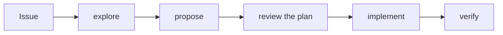

When an AI agent writes code fast, the hard part stops being typing and becomes **knowing what was asked, what was done and whether it is right**. Without that, you are left with a lot of code that looks right and that nobody can explain shortly after.

To deal with this, I use a simple workflow in my day-to-day work. To show it, I will use a personal project, a [finance manager built with Django](https://github.com/leodramaral/projeto-gestor-financeiro). The method is called **Spec-Driven Development (SDD)**: I first write what is going to be done, then I review it, and only then does the agent implement. For that I use **OpenSpec**, and to give each piece of work a starting point, **GitHub Issues**.

## One rule

In the project's `AGENTS.md`, the file the agent reads before starting, it says:

> Do not implement without a change.

A *change* is an OpenSpec folder that describes what will change and why. A new screen, a new business rule, a new table, nothing is born outside of a change. It applies to me and to the agent.

## What is inside a change

- **proposal**: why it exists, what changes and what stays **out**;
- **specs**: how the system should behave, written as requirements and scenarios;
- **design**: the technical decisions and the alternatives I discarded;
- **tasks**: the steps, each with a way to check it is done.

The specs matter most. A real excerpt, from the goals feature (the project's text is in Portuguese, so this is a translation):

```markdown
### Requirement: Goal creation
The authenticated user MUST be able to create a goal with a name, a target
amount and, optionally, a deadline. A deadline, if given, MUST NOT be in the past.

#### Scenario: Deadline in the past
- **WHEN** the user submits a deadline earlier than today
- **THEN** no goal is created
- **AND** the form shows the deadline error in Portuguese
```

I can read this text and disagree with it before any code exists. And the agent uses the same text to know when it is done.

## The role of Issues

The Issue is where everything starts: it describes the problem, what is wanted and the acceptance criteria. The change id is its number plus a name, like `9-metas-financeiras`. The branch uses the same id and commits start with the number (`feat(#9): ...`). So from any commit I can get back to the Issue and to the spec that justifies it.

## The flow



1. **Issue.** The problem and the acceptance criteria.
2. **Explore.** If the idea can be read more than one way, I talk it through with the agent before proposing anything.
3. **Propose.** The agent generates proposal, specs, design and tasks in one go.
4. **Review the plan.** I read everything, cut, adjust and decide. It is the stage where mistakes are cheapest, because changing a sentence costs far less than changing a finished screen.
5. **Implement.** The agent follows the tasks in order and only ticks one once it has checked that it works.
6. **Verify.** Tests, spec validation and a manual check in the browser, against the Issue's criteria.

Whatever shows up along the way has a clear destination. If it is part of the scope, it becomes a task **before** it is done. If not, it becomes a new Issue and the current work does not drift.

## A real case: the goals feature

[Issue #9](https://github.com/leodramaral/projeto-gestor-financeiro/issues/9) asked for financial goals: the user sets an objective (say, saving R$ 500), records how much has been saved and follows it on a progress bar. These were the steps.

**Propose.** The proposal made clear what was in and what was out. In: creating, editing, deleting, recording progress and completing goals, with data separated per user. Out: linking a goal to transactions or to the balance, a history of deposits and deadline reminders. Putting money into a goal, for instance, does **not** create a transaction. That avoided an argument that would otherwise have come up in the middle of implementation.

**Review the plan.** Here the plan asked for something unusual. The goals screen did not exist yet, so the first task was to design **two layout options** and stop. One with cards, the other with a list of rows, like the transactions list. The next task was literally a stop for a decision. I compared the two and chose the list: it is more compact and matches the rest of the app. The choice was recorded in `design.md`, with the reason, and the discarded option was removed. Not a line of code had been written.

**Implement.** Only after the choice did the agent follow the tasks, starting with the model and the rules (target amount above zero, a deadline that cannot be in the past, a bar capped at 100%), then the forms, the screens and the tests for access and for isolation between users. Each task said how to check it. For example, the model tests covered the bar at 0%, 50%, 99.9% (which shows 99, not 100) and above the target.

**A detour, handled the way the flow says.** Along the way I realized the deadline field needed a date picker. It was within scope, so it became a new group of tasks in the same plan (with the chosen library and the reason noted) and only then was it done. Had it been something else, it would have become an Issue.

**Verify.** The last task was to check, one by one, the spec's requirements and the Issue's acceptance criteria against the app and the tests. Only then was the change archived, and the goals spec became part of the project's specs.

## Why it works for me

- **I review the text, not just the code.** Agreeing with a page of specification is easier than understanding a diff of dozens of files.
- **The agent has a finish line.** "Done" means tasks checked, not code that compiles.
- **The history explains the decisions.** Months from now, "why the list and not the cards?" has a written answer, and it does not depend on anyone remembering, least of all the agent, which keeps no conversation at all.

## Why OpenSpec and not Spec Kit

There are other tools for SDD, and the best known is Spec Kit, from GitHub itself. I know it is the most widely adopted in the market today. I found it too bureaucratic for my use, because of the number of files and steps it brings.

OpenSpec felt leaner to me. A change has just four documents, and the flow fits in a few commands.

I still plan to try Spec Kit on a project. For now, OpenSpec is working well for me.

## What it costs

It takes work. Every change makes me read and adjust the plan before any screen works. The agent writes the documents in minutes, but I am the one who checks that they are right, and that takes time.

For small changes it can also be overkill. A simple bug, a layout adjustment or a text fix does not need a proposal or specs, and I do not even open a change.

To decide, I ask myself which is more expensive, writing the plan or fixing later what the agent misunderstood. When the change touches a business rule, a screen or data, writing the plan is cheaper.

## Getting started

You can try it on a project of your own in an afternoon.

1. Install [OpenSpec](https://github.com/Fission-AI/OpenSpec) with `npm install -g @fission-ai/openspec` and run `openspec init --tools claude` at the root of the repository. This creates the `openspec/` folder and the `/opsx:explore`, `/opsx:propose`, `/opsx:apply` and `/opsx:archive` commands in Claude Code.
2. Ask the agent itself to fill in `openspec/config.yaml` with the project's stack, language and rules, and to write the rule "do not implement without a change" in `AGENTS.md`.
3. Pick a small Issue that still touches a real rule or screen. Create a branch with its number and run `/opsx:propose`.
4. Read the proposal, the specs and the tasks carefully, adjust whatever you do not like and only then run `/opsx:apply`.
5. At the end, check the result against the Issue's criteria and archive the change with `/opsx:archive`.

The first time, the plan will seem too long. After two or three changes, you will know what to cut.
